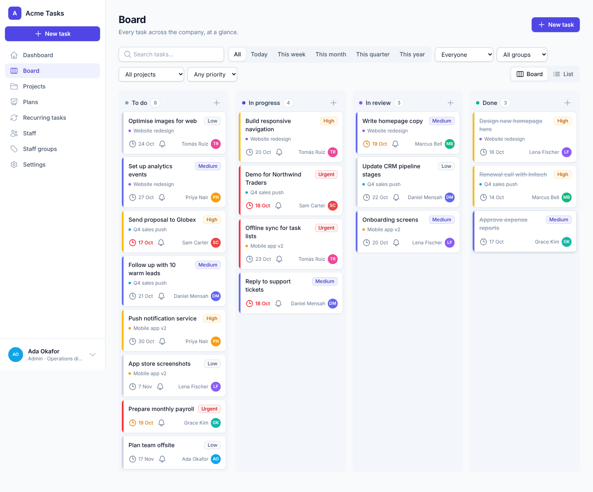
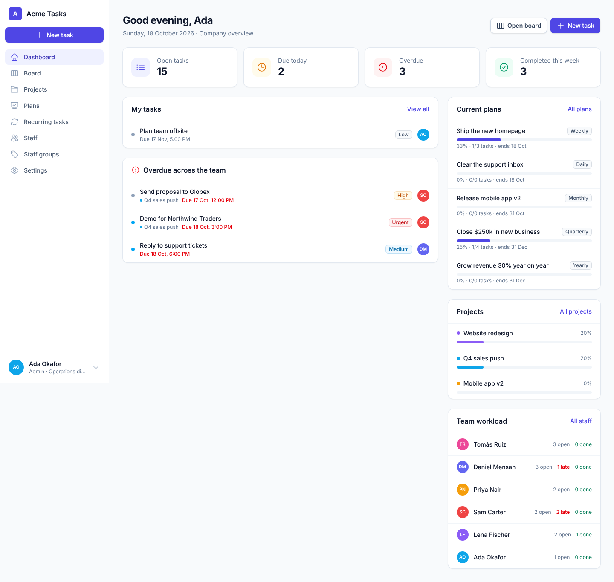
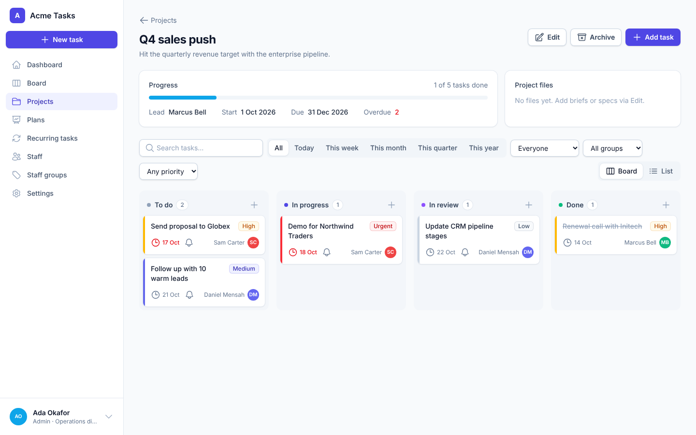
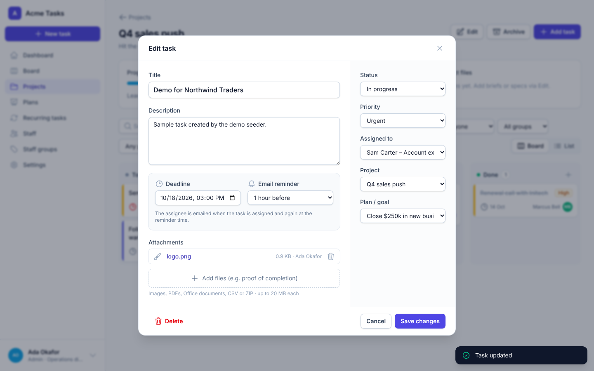
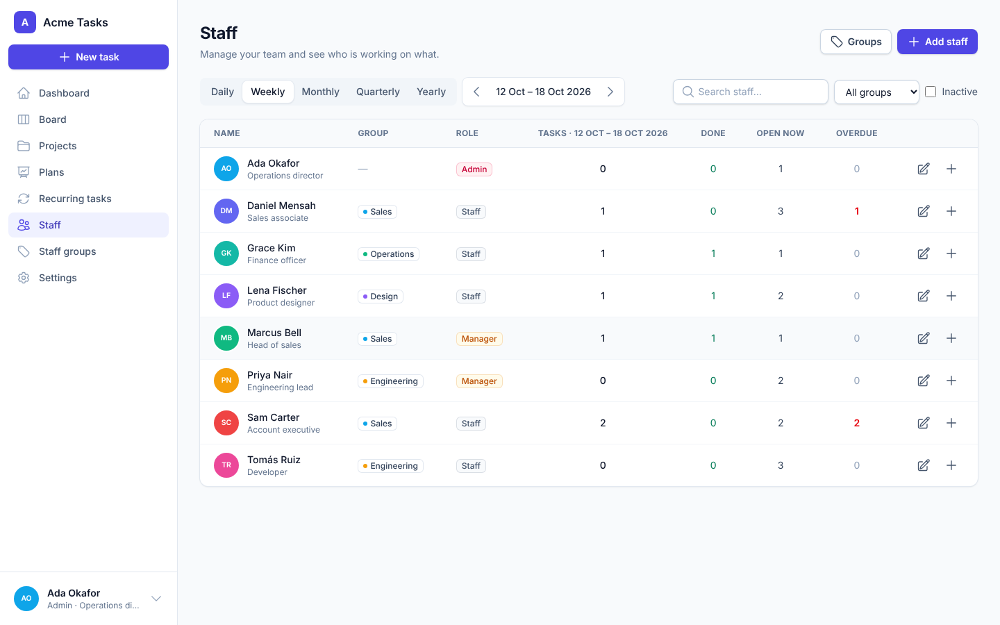
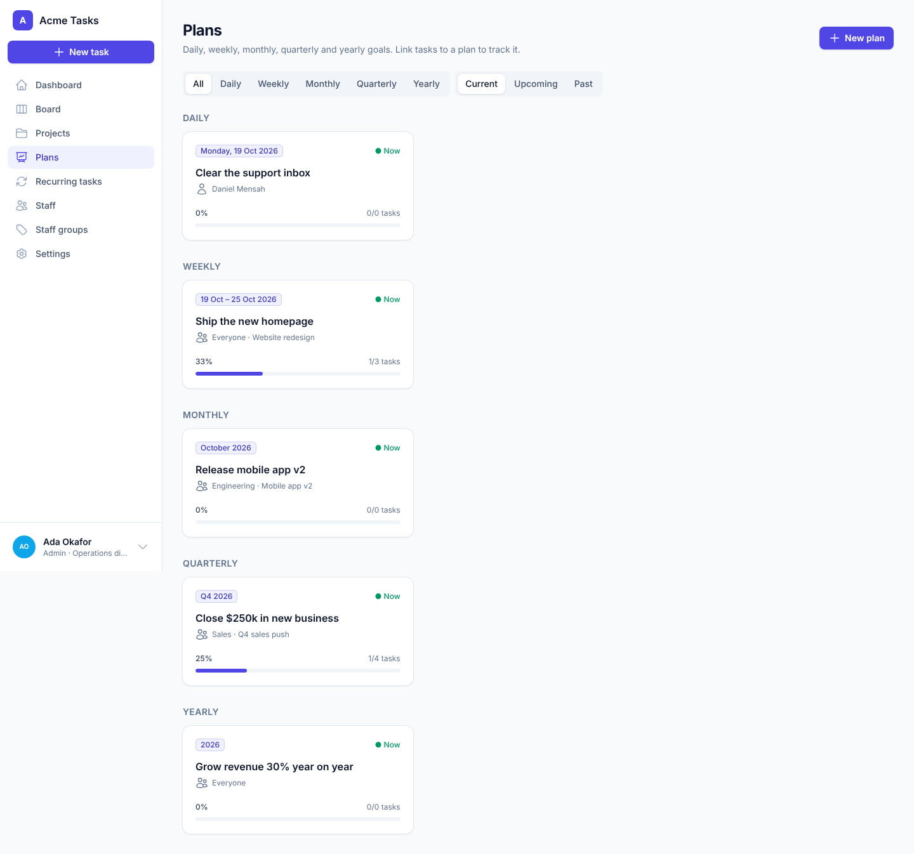
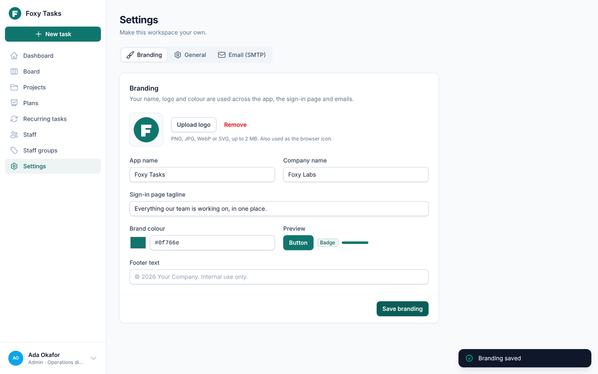
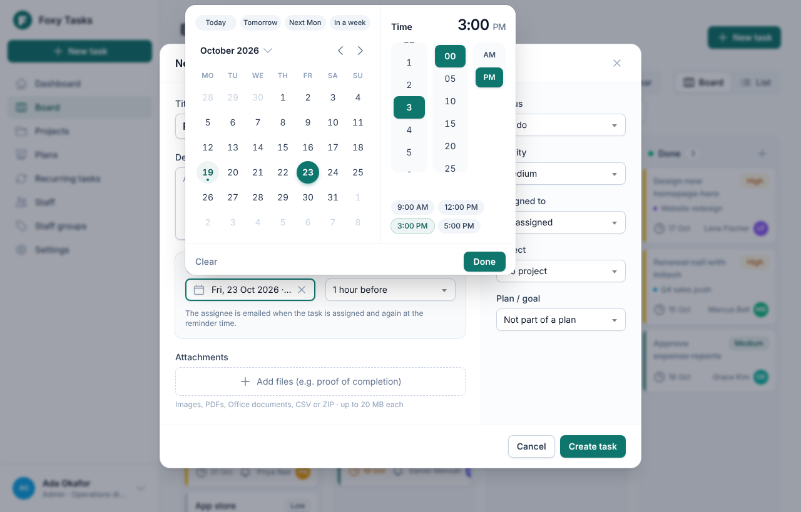
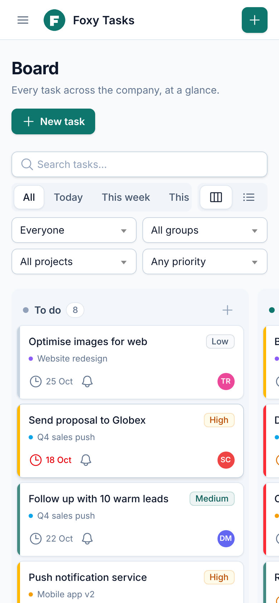

# Task Tracker

[](https://github.com/thefoxylabs/simple-task-tracker/actions/workflows/tests.yml) [](LICENSE)

**An open-source, self-hosted, white-label task tracker for teams.**

🌐 **Website:** https://thefoxylabs.github.io/simple-task-tracker/
Download it, host it on your own server and brand it as your own: name, logo and colours are all set from the admin **Settings** page.

Built with **Laravel 12**, **Livewire 4** and **Tailwind CSS 4**.



## Features

- **Kanban board.** Every task in one place, with To do / In progress / In review / Done columns, drag and drop, colour-coded priorities (Low, Medium, High, Urgent), the assignee on every card, deadlines and overdue highlighting. Switch to a list view at any time.
- **Filters.** Today, this week, month, quarter or year; by person, staff group, project or priority; and a free-text search.
- **Projects.** Group tasks by project, track progress, set a lead and dates, and attach briefs or specs. Archive finished projects and restore them later.
- **Plans.** Daily, weekly, monthly, quarterly and yearly goals for a person, a staff group or the whole company. Link tasks to a plan to see its progress.
- **Recurring tasks.** Routine work that is created and assigned automatically every day, week, month, quarter or year.
- **Deadlines and email reminders.** Whoever sets a task chooses the deadline and when the reminder email goes out. Assignees are also emailed when a task is assigned to them.
- **Staff tracking.** See each person's tasks for any day, week, month, quarter or year, with completed, open and overdue counts.
- **Staff and groups.** Add staff (with an email invitation to set their password), organise them into groups such as departments, and deactivate leavers.
- **Attachments.** Upload files to tasks (for example, proof of completion) and to projects. Files are stored in **Cloudflare R2** by default, or locally or in S3.
- **White-label branding.** App name, company name, logo, brand colour, sign-in tagline and footer text.
- **A custom date and time picker.** A calendar with month and year views, shortcuts (Today, Tomorrow, Next Monday, In a week), a scrollable time picker with common times, and keyboard support. On phones it opens as a bottom sheet.
- **Works on phones.** Every page and form is responsive: swipeable board columns, card layouts instead of tables, and tab rows that scroll sideways.
- **Searchable dropdowns.** Every dropdown uses Select2, so you can type to find people, projects, plans or time zones.
- **SMTP settings in the app.** Configure mail from the Settings page and send a test email, or use `.env`.

## Roles and permissions

| | Admin | Manager | Staff |
|---|:-:|:-:|:-:|
| See the board, projects and plans | ✅ all tasks | ✅ all tasks | ✅ their own tasks |
| Create tasks | ✅ for anyone | ✅ for anyone | ✅ for themselves |
| Edit a task's details, deadline and reminder | ✅ | ✅ | ✅ only tasks they created |
| Move their tasks on the board and attach files | ✅ | ✅ | ✅ |
| Create, edit and archive projects, plans and recurring tasks | ✅ | ✅ | – |
| Add and edit staff and staff groups | ✅ everyone | ✅ staff accounts | – |
| View any person's work by period | ✅ | ✅ | ✅ only their own ("My work") |
| Delete projects | ✅ | – | – |
| Settings: branding, SMTP, time zone | ✅ | – | – |

## Screenshots

| Dashboard | Project |
|---|---|
|  |  |
| **Task with deadline, reminder and files** | **Staff by period** |
|  |  |
| **Plans** | **Branding settings** |
|  |  |
| **Date and time picker** | **On a phone** |
|  |  |

## Requirements

- PHP 8.2+ with the `intl`, `mbstring`, `pdo_mysql` (or `pdo_sqlite`), `fileinfo` and `zip` extensions
- Composer 2
- Node.js 20+ (only to build the CSS/JS)
- MySQL 8 / MariaDB 10.6+ (recommended) or SQLite
- A Cloudflare R2 bucket for uploads (or set `FILESYSTEM_DISK=local`)
- An SMTP account for email

## Installation

```bash
git clone https://github.com/thefoxylabs/simple-task-tracker.git task-tracker
cd task-tracker

composer install --no-dev --optimize-autoloader
cp .env.example .env
php artisan key:generate

# Edit .env: APP_URL, database, mail (SMTP) and storage (R2), then:
php artisan migrate --force

npm ci && npm run build
```

Point your web server's document root at the `public/` folder, then open the site. The **setup wizard** asks for your workspace name and creates the first admin account.

> **Tip:** On a public server, set `SETUP_TOKEN` in `.env` before the first visit. The setup wizard will then only accept that secret, so nobody else can claim the admin account.

### Scheduler (required for reminders and recurring tasks)

Add this cron entry on the server:

```cron
* * * * * cd /path/to/task-tracker && php artisan schedule:run >> /dev/null 2>&1
```

It sends reminder emails every minute and creates recurring tasks every 15 minutes.

### Docker

```bash
cp .env.example .env      # set APP_KEY (php artisan key:generate --show), APP_URL, SMTP and R2
docker compose up -d      # app on http://localhost:8080, MySQL and the scheduler
```

## Configuration

Everything lives in `.env` (see `.env.example`, which is fully commented).

### File storage: Cloudflare R2 (default)

1. In the Cloudflare dashboard, create an R2 bucket.
2. Create an **R2 API token** with *Object Read & Write* access to that bucket.
3. Fill in `.env`:

```dotenv
FILESYSTEM_DISK=r2
R2_ACCESS_KEY_ID=your-access-key-id
R2_SECRET_ACCESS_KEY=your-secret-access-key
R2_BUCKET=task-tracker
R2_ENDPOINT=https://<ACCOUNT_ID>.r2.cloudflarestorage.com
```

The bucket can stay private: downloads use short-lived signed links, and only signed-in users who can see a task can download its files.
To store files on the server instead, set `FILESYSTEM_DISK=local`. For Amazon S3 or another S3-compatible service, set `FILESYSTEM_DISK=s3` and fill in the `AWS_*` values.

### Email (SMTP)

Set `MAIL_*` in `.env`, or have an admin enter SMTP details under **Settings → Email (SMTP)**. The in-app settings take priority, the password is stored encrypted, and there is a **Send test email** button.

### Branding

An admin can change these under **Settings → Branding**:

- App name and company name
- Logo (also used as the browser icon)
- Brand colour (buttons, highlights and links are derived from it)
- Sign-in page tagline and footer text

To go further, the UI is plain Blade and Tailwind in `resources/views`, and the colour scale is defined in `resources/css/app.css`.

## Try it with demo data

```bash
php artisan migrate:fresh --seed --seeder=DemoSeeder
```

Sign in as `admin@example.com`, `manager@example.com` or `staff@example.com`. The password for each is `password`.

## Development

```bash
composer install && npm install
cp .env.example .env && php artisan key:generate
# For local development set: DB_CONNECTION=sqlite, FILESYSTEM_DISK=local, MAIL_MAILER=log
php artisan migrate --seed --seeder=DemoSeeder
composer dev        # web server, scheduler, logs and Vite together
```

Run the checks before opening a pull request:

```bash
php artisan test
vendor/bin/pint
```

### Project layout

| Path | What's there |
|---|---|
| `app/Livewire` | Pages and modals: Board, TaskForm, Projects, Plans, Staff, Settings… |
| `app/Models` | Task, Project, Plan, RecurringTask, StaffGroup, Attachment, User |
| `app/Enums` | Roles, task statuses, priorities and planning periods |
| `app/Console/Commands` | `tasks:send-reminders`, `tasks:generate-recurring` |
| `app/Support/Settings.php` | Company settings (branding, SMTP) stored in the database |
| `resources/views` | Blade views and UI components |

## Need help installing?

**Foxy Labs**, who built Task Tracker, can set it up or host it for you:

| Package | Price | What you get |
|---|---|---|
| **Basic install** | from **$250** one-time | Installed on your server: domain and HTTPS, database, email, file storage, branding and the reminder scheduler |
| **Full setup** | **$500** one-time | Basic install, plus hosting set up for you, your staff and first projects added, a training session and 30 days of help |
| **Managed hosting** | from **$99**/month | We host and run your private, branded workspace, with backups, monitoring, updates and support. No server needed. |
| **Maintenance plan** | from **$49**/month | Updates, backups, monitoring and help for self-hosted installs |
| **Custom work** | Quote | New features, integrations, or moving over from Trello, Asana or spreadsheets |

See the [website](https://thefoxylabs.github.io/simple-task-tracker/#help) for details.

Get in touch:

- **Email:** [hello@thefoxylabs.com](mailto:hello@thefoxylabs.com?subject=Task%20Tracker%20installation)
- **WhatsApp:** [+234 708 640 7310](https://wa.me/2347086407310)
- **Website:** [thefoxylabs.com/contact-us](https://thefoxylabs.com/contact-us/)

## Changelog

See [CHANGELOG.md](CHANGELOG.md) for what's new in each release.

## Contributing

Contributions are welcome. See [CONTRIBUTING.md](CONTRIBUTING.md) and our [Code of Conduct](CODE_OF_CONDUCT.md). To report a security problem, please follow [SECURITY.md](SECURITY.md).

## License

Task Tracker is open-source software released under the [MIT license](LICENSE).
